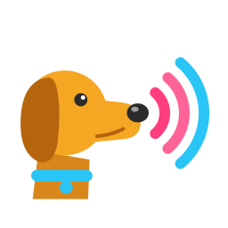
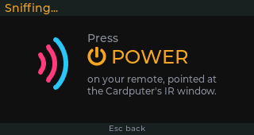
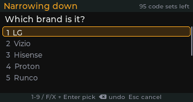
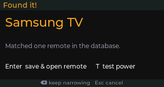
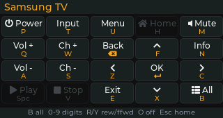

<p align="center"></p>

# Beamhound

**Sniffs out your IR remote from one button press, then becomes it.** An app for the
M5Stack Cardputer Zero.

<p align="center">
  
  
  
  
</p>

## How it works

1. Point a remote at the Cardputer and press **Power**.
2. Beamhound decodes the signal and finds every remote in the
   [Flipper-IRDB](https://github.com/Lucaslhm/Flipper-IRDB) database with that power code.
3. Remotes with identical codes count as one answer, so it only asks questions that actually
   separate the remaining code sets. Each turn it picks the cheapest useful question:
   *press another button on your remote*, *pick the device type*, *pick the brand*, or
   *did your device react to this test signal?*
4. Once matched, the profile is saved and you get a remote-control screen.

In simulation against the database (a virtual user holding each of 3000 random remotes and
answering truthfully), it identified a working code set every time, with 1.5 questions on
average and none for about a third of remotes.

**Supported protocols:** NEC / NECext / NEC42, Samsung32, RC5 / RC5X, RC6, Sony SIRC 12/15/20,
Kaseikyo (Panasonic), RCA and Pioneer, plus fuzzy matching of raw signal shapes for remotes the
decoders don't cover. Air conditioners are excluded for now; their remotes send full state, not
simple codes.

## Keys

| Screen | Keys |
|---|---|
| Lists | **F/X** move (also Fn+arrows, W/S), **1-9** pick, **Enter** select |
| Questions | press the named button on your remote, **N** my remote doesn't have it, **B** best guess, **Backspace** undo |
| Remote | **P** power, **Q/A** vol, **W/S** channel, **M** mute, **T** input, **U** menu, **H** home, **F/Z/X/C** arrows, **Enter** OK, **Backspace** back, **Space** play, **R/V/Y** rew/stop/ffwd, **0-9**, **B** all buttons, Fn+A/S/D mute/vol, Fn+Q/W/E play/rew/ffwd, Fn+U/I brightness |
| Anywhere | **Esc** back, hold **Esc** to exit |

## Database

The IR codes are not bundled. On first run the app downloads a pinned snapshot of Flipper-IRDB
(about 17 MB) with `curl`, extracts the `.ir` files and builds its index on the device in
`~/.local/share/beamhound/`. The database is a community project with its own license.

## Building

Requires `make`, a C++17 compiler and LVGL v9.5.0:

```sh
git clone --depth 1 --branch v9.5.0 https://github.com/lvgl/lvgl.git deps/lvgl
make cross      # cross-compile on a PC with Zig (fetched via uv): build/cross/beamhound
make package    # Application Store .deb in build/pkg/
make deploy     # install on a Cardputer over ssh (DEVICE=cardputer)
make desktop    # headless preview; ./build/desktop/beamhound --demo <dir> writes screenshots
make tools test # index builder, decoder tests and the matcher simulation (needs build/data,
                # made with build/host/build_index <Flipper-IRDB checkout> build/data)
```

Building directly on the Cardputer (`make`) works but takes a long time and a lot of memory, so
cross-compiling is recommended. `make cross` targets glibc 2.36 and links libc++ statically.

## Layout

- `src/core/`: IR codec, `.ir` parser, index format and builder, matcher (no UI dependencies)
- `src/platform/`: LIRC receive/transmit and evdev keyboard
- `src/app/`: LVGL screens and first-run database setup
- `tools/`, `tests/`: index builder, decoder tests against the database, matcher simulation

## License

MIT. See [LICENSE](LICENSE) for third-party notices.
